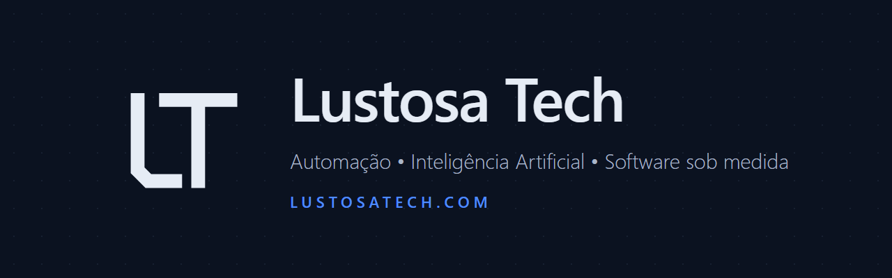

  

  
  
  

## Quem somos

A **Lustosa Tech** é uma consultoria de tecnologia *business first*: começamos pelo problema do seu negócio, não pela ferramenta.

Somos Renan e Joab Lustosa, desenvolvedores com mais de 20 anos somados construindo sistemas, 15 deles na logística. Hoje levamos essa experiência para empresas de qualquer setor.

## O que fazemos

| Serviço | O que entrega |
|---|---|
| **Automação de processos** | Menos planilha manual, retrabalho e erro humano |
| **Inteligência Artificial aplicada** | Agentes de IA, atendimento no WhatsApp, leitura de documentos e relatórios automáticos |
| **Software sob medida** | Sistemas web, APIs e painéis de gestão |
| **Integração de sistemas** | ERPs, plataformas e ferramentas conversando entre si |
| **Modernização de legados** | Sistemas antigos atualizados sem parar a operação |
| **Diagnóstico de tecnologia** | Onde investir para ter mais retorno |

## Como trabalhamos

1. Entendemos a sua operação e o que hoje custa tempo e dinheiro.
2. Propomos a solução mais simples que resolve o problema.
3. Entregamos em etapas curtas, com resultado medido.

## Código aberto

Ferramentas que usamos no dia a dia e abrimos para a comunidade (licença MIT):

| Projeto | O que faz |
|---|---|
| [octo-cluster](https://github.com/renanflustosa/octo-cluster) | Plugin do Claude Code: commits lógicos e seguros, prompts prontos para rodar e contexto enxuto |
| [assistente-financeiro](https://github.com/renanflustosa/assistente-financeiro) | CLI de controle financeiro PF + PJ: importa extratos OFX/CSV e classifica os lançamentos |
| [assistente-fiis](https://github.com/renanflustosa/assistente-fiis) | CLI que sugere o aporte mensal em fundos imobiliários |
| [template-e2e](https://github.com/renanflustosa/template-e2e) | Modelo de testes de aceite com Playwright: um teste por critério, vídeo como evidência e CI |

## Stack

`TypeScript` · `Node.js` · `Next.js` · `React` · `Angular` · `Go` · `C# / .NET` · `MySQL` · `PostgreSQL` · `Playwright` · `Claude Code`

## Fale com a gente

Especialistas em logística, prontos para qualquer negócio. Mande uma mensagem pela [página no LinkedIn](https://www.linkedin.com/company/lustosatech/) ou acesse [lustosatech.com](https://www.lustosatech.com/).
